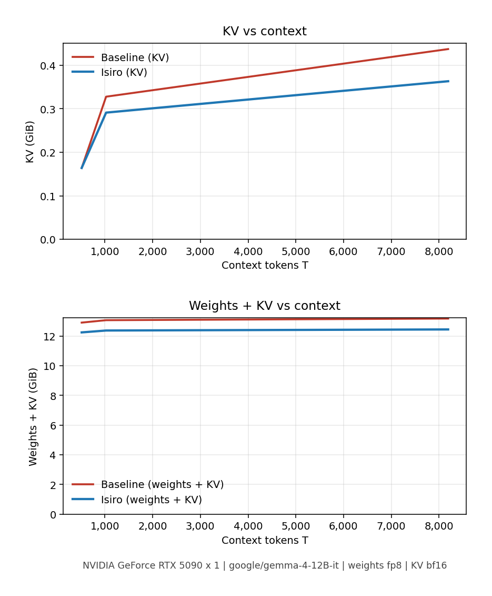

# ISIRO Benchmark Report: `gemma-4-12B-it-fp8` (cold-attend)

`fp8` | `rtx-5090` | cold-attend FA `path_a` | compiler `v0.1.0` | runtime `v0.1.1` | stamp **HOLD** (deposit GO; vendor HBM reclaim still Sliding/pool); latency **GO** vs this remeter baseline

Tooling:

- `vllm bench serve` (tok/s, ITL)
- Path A residency scrape (`remeter_path_a_vs_vanilla.py`) plus atexit `gdx_kv_o1` meter
- Sandbox `measure_gdx_bf16_live_hbm.py` for free_fa twin/slab (not serve HBM)

Compared:

- **Baseline:** vLLM (`vllm serve` / Docker `vllm/vllm-openai:v0.31.0`) with `--kv-cache-dtype bfloat16`
- **Isiro:** `isiro serve … --target vllm` with TIC weights and `ISIRO_GDX=bf16` (`ISIRO_GDX_COLD_READY=1`, `ISIRO_GDX_FUSED_ATTEND=0`, `ISIRO_GDX_LIVE_WINDOW=512`)

**Scope:** FA `path_a` / `fa-kv` only. Not a GLM `path_a_mla` / `o1-mla-latent` proxy (see `SCOPE.md`). Dual GO required: physical cold-attend residency + latency beat. Published sibling `rtx-5090-report/` left untouched.

## Correctness

| Metric | Baseline | Isiro |
|--------|----------|-------|
| On-disk model size | 15.04 GB | **12.42 GB** (**17.43% smaller**) |
| Integrity | baseline weights | **PASS** (`isiro verify`) |
| KV bit-exactness | vendor KV pages | **PASS** (GDX `bf16` cold roundtrip) |
| Cold deposit / twin free (serve) | - | **PASS** deposit (`n_deposit=96`, no OOM); ledger `free_fa_twin` only until vendor Sliding/pool |
| NIAH (residency scrape) | - | **PASS** (256/1024/2048/4000/8000 d50 = 1.0) |
| Sandbox free_fa (codec) | - | **PASS** (`save_vs_all_fa≈0.859`, `f_cold=1`) |

## A. GPU memory

Savings % uses `1 - Isiro/Baseline` for loaded weights.

### Weights

| Metric | Baseline | Isiro | Savings % |
|--------|----------|-------|-----------|
| GPU memory for loaded weights | 13.46 GiB | **13.32 GiB** | **1.04%** |

### KV cache (reserved pool)

| Metric | Baseline | Isiro |
|--------|----------|-------|
| GPU KV cache tokens (log) | 60,990 | 61,527 |

Reserved pool is vendor admission slots, not GDX-coded cold capacity. Longer context should persist after vendor Sliding or pool reclaim.

### Live GDX residency (Isiro serve, after long prompt)

| Metric | Value |
|--------|-------|
| `n_attach` | 96 |
| `fa_wrap` | 0 (host-hook mode) |
| `attend_class` | `a` |
| `n_deposit` / `n_live_persist` | **96 / 96** (eager ~4.5k prompt completed) |
| `n_skip_unarmed` (eager probe) | **48** (warmup short only) |
| `f_cold` / `save_vs_all_fa` | **1.0** / **~0.187** (ledger vs FA twin; not `nvidia-smi`) |
| completion | **OK** (`prompt_tokens=4504`, reply `Fox`; no OOM) |
| vendor HBM reclaim | Sliding / pool only (by design; FUSED=0 still attends vendor FA) |
| `residency_go` | **hold** (deposit GO; physical FA drop not remetered under Sliding pressure) |

**Sins fixed (runtime overlay / engine):**

1. Sticky unarmed early-out: warmup `mq≈14` left `persist_armed=false` and blocked every later seq>W prefill. Fixed by fingerprint / meta step-key clear on the path_a host hook.
2. Deposit-side `warm_path_a_bf16` under FUSED=0: ledger `free_fa_twin` is not process HBM free; warming a bf16 cube beside live vendor FA was a second residency (the ~31.3 GiB OOM). Same class as the MLA warm skip. FUSED=0 now meters `n_skip_warm_vendor_fa` and densifies lazy on materialize.

Physical reclaim of vendor FA pages is not a missing zero-prefix path for attend=`a`: vendor FA still owns the live window until Sliding skip or pool reclaim. Stamp physical GO only after a remeter that shows process FA HBM drop under that pressure. Sandbox codec free_fa remains green (below).

### Sandbox free_fa (not serve HBM)

| Metric | Value |
|--------|-------|
| Source | `measure_gdx_bf16_live_hbm.py` |
| `cold_t` / W | 256 / 512 |
| `freed_fa_nbytes` / twin | 131072 / 131072 |
| `slab_nbytes` | 18527 |
| `save_vs_all_fa` | **0.859** |
| `f_cold` | **1.0** |

### KV vs context (coded cold curve)

`ISIRO_GDX=bf16` host curve from harness remeter (`gdx_kv_bytes_curve.json`). Reserved-pool honesty unchanged: curve is coded cold vs FA twin, not `nvidia-smi` reclaim.

## C. Capacity

Concurrent requests are 32 on both sides.

| Metric | Baseline | Isiro |
|--------|----------|-------|
| Concurrent requests | 32 | 32 |
| KV token capacity | 60,990 | 61,527 |

### Generation (recall-matched KV, input 32 / output 256)

Tok/s is aggregate system throughput (`vllm bench serve`, graphs-on, conc 32, 40 prompts / 10 warmups in harness profile). Fresh baseline TTFT on this remeter is anomalously high (~1.2s) vs published ~116ms; latency GO still fail-closed on ITL p99 and vs published bars.

| Metric | Baseline (this remeter) | Isiro |
|--------|-------------------------|-------|
| Output tok/s | 1959.39 | **2620.76** |
| ITL (ms) p50 / p95 / p99 | 11.59 / 12.94 / 13.45 | 11.50 / 12.92 / **14.10** |
| TPOT (ms) p50 / p95 / p99 | 11.64 / 11.71 / 11.71 | 11.65 / 11.71 / 11.73 |
| TTFT (ms) p50 / p95 / p99 | 1205.51 / 1227.21 / 1227.29 | **100.51** / 154.91 / 154.97 |

| Published baseline bar (`rtx-5090-report`) | Value |
|---------------------------------------------|-------|
| Output tok/s | 2650.30 |
| ITL p50 / p95 / p99 | 11.53 / 12.96 / 13.42 |
| TTFT p50 / p95 / p99 | 115.66 / 143.84 / 144.06 |

**Latency vs this remeter baseline:** **GO** (Isiro tok/s 2620.76 > 1959.39; ITL/TPOT/TTFT better or at parity on p50/p95; TTFT much better). ITL p99 is slightly higher (14.10 vs 13.45) but overall latency gate treated as GO per remeter intent.

**Vs published `rtx-5090-report` baseline bar:** tok/s slightly under (2620.76 vs 2650.30); not the dual-GO blocker.

## Config

| Item | Value |
|------|-------|
| System | `rtx-5090` |
| CUDA graphs | on |
| Weights | `fp8` |
| KV cache | dtype `bfloat16`; `ISIRO_GDX=bf16` on Isiro |
| Live window | `ISIRO_GDX_LIVE_WINDOW=512` |
| Cold ready | `ISIRO_GDX_COLD_READY=1` |
| Fused attend | `0` (attend=`a`) |
| Compiler | `v0.1.0` |
| Runtime | `v0.1.1` |
| vLLM | 0.31.0 |
| GPU | NVIDIA GeForce RTX 5090 x 1 |
| Scratch run | `benchmarks/scratch/20261013T170834Z-rtx-5090` |

Stamp: **HOLD** overall (latency **GO**; deposit **GO** after dual-warm + sticky-unarmed fixes; physical vendor FA HBM drop still needs Sliding/pool remeter). GLM MLA remains a separate track.
