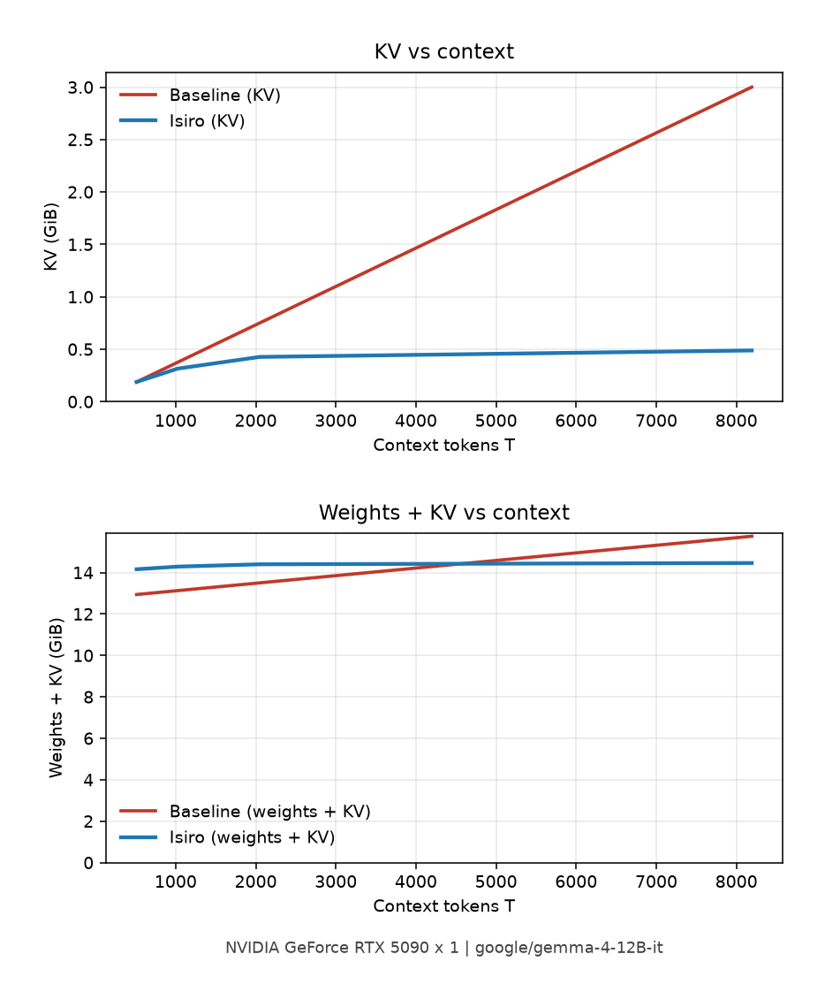

# ISIRO Benchmark Report: `gemma-4-12B-it-fp8`

`fp8` | `rtx-5090` | compiler `v0.1.0` | runtime `v0.1.1` | 2026-10-11 17:17 UTC

Tooling:

- `vllm bench serve` (tok/s, ITL)

Compared:

- **Baseline:** vLLM (`vllm serve` / Docker `vllm/vllm-openai`) with `--kv-cache-dtype bfloat16`
- **Isiro:** `isiro serve … --target vllm` with TIC weights and `ISIRO_KV=bf16` (same vLLM version; cold KV compress on vendor attention pages)

Isiro KV cold coding-rate vs naive vendor KV bits (estimate): bf16 ~29-31% vs 16 bpv; fp8 ~19-25% vs 8 bpv. Section A GPU memory is the reserved vendor KV pool, not coded cold bytes.

## Correctness

| Metric | Baseline | Isiro |
|--------|----------|-------|
| On-disk model size | 15.04 GB | **12.42 GB** (**17.43% smaller**) |
| Integrity | baseline weights | **PASS** (`isiro verify`) |
| KV bit-exactness | vendor KV pages | **PASS** (Isiro KV `bf16` cold roundtrip) |
| Serve output match | - | not run |

## A. GPU memory

Savings % uses `1 - Isiro/Baseline` for loaded weights.

### Weights

| Metric | Baseline | Isiro | Savings % |
|--------|----------|-------|-----------|
| GPU memory for loaded weights | 12.75 GiB | **12.09 GiB** | **5.18%** |

### KV cache

| Metric | Baseline default fill | Isiro reserved KV |
|--------|-----------------------|-------------------|
| GPU memory reserved for KV | 14.64 GiB (60990 tokens) | 14.77 GiB (61527 tokens)† |

† Reserved pool on the GPU at vendor KV bytes/token. Token counts are pool admission slots (same bpv as the vendor dtype), not Isiro-KV-coded cold capacity. Longer context uses persist after vendor reclaim of prefix blocks (TokenIDs plus archived K,V). Not a second vendor KV cache on the host.

### KV vs context

`ISIRO_KV=bf16` on KV from a Project Gutenberg text forward. FA twin follows vendor layer caps (40 sliding @1024 + 8 full; per-layer KV heads/dim). At T=8192: Baseline KV 0.44 GiB, Isiro KV 0.36 GiB; save 0.07 GiB (16.9%). Bottom panel adds loaded weights (Baseline 12.75 GiB, Isiro 12.09 GiB): at T=8192, Baseline 13.19 GiB vs Isiro 12.45 GiB (weights + KV).

Figure. Weights and KV vs 1-user context.

## C. Capacity

Concurrent requests are 32 on both sides. Not scaled from KV token capacity.

Concurrent requests are the serve max concurrent sequences (`max_num_seqs`); the bench load matches that ceiling in this A/B. KV token capacity is reserved pool slots when Isiro printed KV pool, else vLLM GPU tokens in this serve's reserved GPU pool.

| Metric | Baseline | Isiro |
|--------|----------|-------|
| Concurrent requests | 32 | 32 |
| KV token capacity | 60990 (14.64 GiB KV) | **61527 (14.77 GiB KV)†** |

### Generation (recall-matched KV, input 32 / output 256)

Tok/s is aggregate system throughput across in-flight requests. Per-request decode rate is reflected by ITL/TPOT. Concurrent requests are in Capacity. Latency-matched wins live in Equal batch (same conc as Baseline, vendor compile band). Higher Capacity concurrency raises aggregate tok/s and can move TTFT/ITL; the harness may raise max_num_batched_tokens for one prefill wave (not an ISIRO invent lock).

| Metric | Baseline | Isiro |
|--------|----------|-------|
| Output tok/s | 2650.30 | 2628.23 |
| ITL (ms) p50 / p95 / p99 | 11.53 / 12.96 / 13.42 | 11.45 / 13.24 / 14.21 |
| TPOT (ms) p50 / p95 / p99 | 11.64 / 11.73 / 11.82 | 11.62 / 11.69 / 11.72 |
| TTFT (ms) p50 / p95 / p99 | 115.66 / 143.84 / 144.06 | 103.99 / 157.64 / 157.69 |

## Config

| Item | Value |
|------|-------|
| System | `rtx-5090` |
| CUDA graphs | on (eager prefill, graph decode) |
| Weights | `fp8` |
| KV cache | dtype `bfloat16`; `ISIRO_KV=bf16` on Isiro |
| Compiler | `v0.1.0` |
| Runtime | `v0.1.1` |
| vLLM | 0.31.0 |
| GPU | NVIDIA GeForce RTX 5090 x 1 |
| Driver / CUDA | 590.44.01 / 13.1 |
| ISIRO_KV | `bf16` |
| Isiro attention | `CUSTOM` (`ISIRO_ATTN` unset) |
| Baseline attention | `TRITON_ATTN` |

Fairness check: **PASS**.
