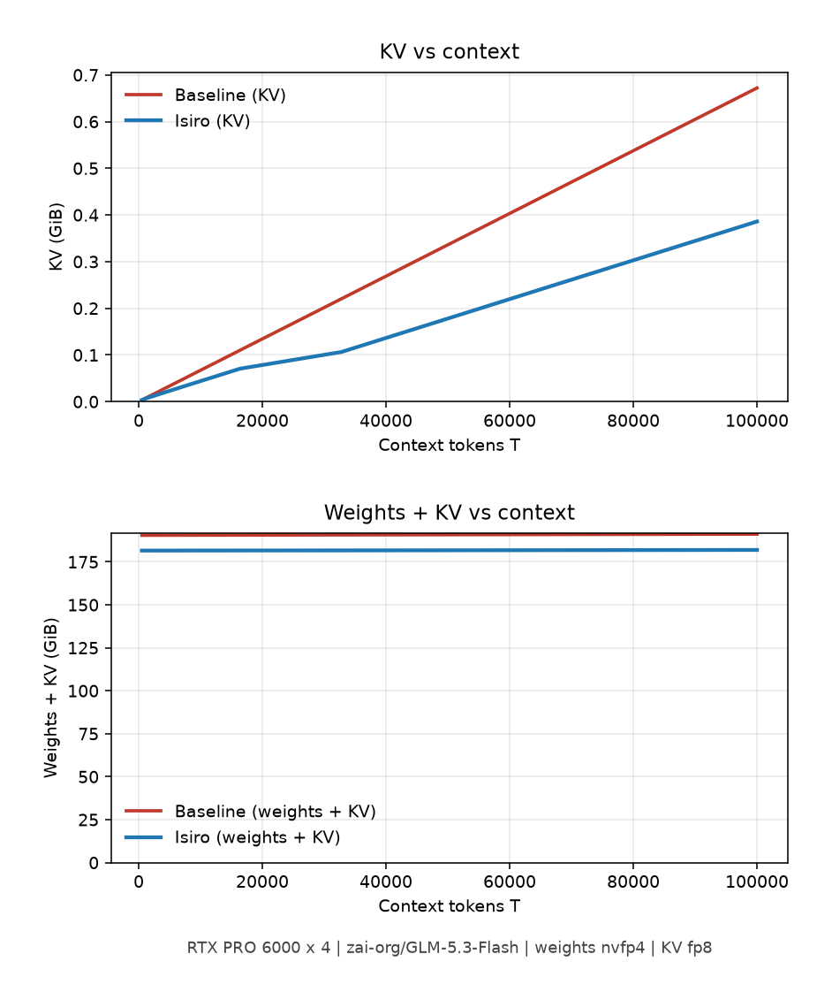

# ISIRO Benchmark Report: `glm-5.3-flash-nvfp4`

`nvfp4` weights | `fp8` KV | `rtx-pro-6000-blackwell` | path_a_mla / o1-mla-latent | 2026-10-13 UTC

Tooling:

- Ambient twin scrape (`remeter_path_a_vs_vanilla.py`) on vast-glm (graphs-on; no Docker)
- GDX KV-bytes curve from vendor MLA latent capture (`mla_latent_real_t100k.npz`, T=100000)

Compared:

- **Baseline:** stock `vllm serve` on Hub NVFP4 (`GLM-5.3-Flash-NVFP4`)
- **Isiro:** `isiro-serve-native` on `GLM-5.3-Flash-NVFP4-TIC` with `ISIRO_GDX=fp8` (route=`path_a_mla`, payload=`o1-mla-latent`, `dual_hold=0`)

Serve knobs matched to TIC `serve.yaml` remeter: TP=4, `max_model_len=8192`, `max_num_seqs=10`, `max_num_batched_tokens=8192`, `gpu_memory_utilization=0.95`, `kv_cache_dtype=fp8`, prefix cache off, flashinfer autotune off, `VLLM_MEMORY_PROFILER_ESTIMATE_CUDAGRAPHS=0`. Isiro: `ISIRO_GDX_LIVE_WINDOW=512`, graphs-on (no `--enforce-eager`).

## Correctness

| Metric             | Baseline                                      | Isiro                                                      |
| ------------------ | --------------------------------------------- | ---------------------------------------------------------- |
| On-disk model size | 190.43 GiB                                    | **181.54 GiB** (**4.67% smaller**)                         |
| Integrity          | baseline weights                              | PASS (TIC load / serve boot)                               |
| KV cold deposit    | vendor MLA pages                              | **PASS** (`n_deposit=11` / `n_mla_hook=11`, `f_cold=1.0`) |
| Dual-hold          | -                                             | **PASS** (`dual_hold=0`, `free_fa_twin` ledger)            |
| NIAH (scrape grid) | PASS through 4000; 8000 d50 HTTP 500          | PASS (256/1024/2048/4000/8000 d50 = 1.0)                 |

## A. GPU memory

Savings % uses `1 - Isiro/Baseline` for loaded weights (on-disk stamp here; serve banner weight delta **4.7%**).

### Weights

| Metric                        | Baseline     | Isiro          | Savings % |
| ----------------------------- | ------------ | -------------- | --------- |
| On-disk / loaded weight bytes | 190.43 GiB   | **181.54 GiB** | **4.67%** |

### KV cache (reserved pool)

| Metric                    | Baseline  | Isiro     |
| ------------------------- | --------- | --------- |
| GPU KV cache tokens (log) | 2,377,500 | 2,273,735 |

Reserved pool is vendor admission slots, not GDX-coded cold capacity. Physical vendor MLA pages still attend after deposit (`free_fa_twin` is ledger-only).

### Live GDX ledger (Isiro, after long prompt)

Cold o1 slab vs synthetic twin (not nvidia-smi). After attach-ordinal fix, all 11 Full MLA layers deposit.

| Metric                 | Value      |
| ---------------------- | ---------- |
| `n_deposit` / hooks    | **11 / 11** |
| `save_vs_all_fa`       | **0.987**  |
| `f_cold`               | 1.0        |
| `slab_nbytes`          | 88976      |
| `mla_latent_raw_bytes` | 6869632    |

`save_vs_all_fa = 1 - slab/raw` on deposited cold (W=512 live window stays twin-dense outside this ledger).

### KV vs context (coded cold)

`ISIRO_GDX=fp8` on vendor MLA latent (`kv_source=vendor_mla_latent`, W=512). Capture T=100000. Hot window amortizes with T; at T=100000: Baseline twin **688.17 MiB**, Isiro total **395.17 MiB**; save **42.6%** (real latent pack rate, not the live ledger 0.987 on the short cold deposit).

Calculated at T=1e6 with the measured cold rate (~0.572 of twin): save **≈42.8%** (asymptote of the curve pack rate). Label: calculated, not remetered.

Figure. Weights and KV vs 1-user context (tagline: `weights nvfp4 | KV fp8`).

## C. Capacity

| Metric              | Baseline | Isiro |
| ------------------- | -------- | ----- |
| Concurrent requests | 10       | 10    |

### Generation (ambient stream scrape, graphs-on)

| Metric               | Baseline | Isiro     |
| -------------------- | -------- | --------- |
| Stream tok/s         | 60.27    | 60.10     |
| Stream ITL p50 (ms)  | 11.62    | **11.50** |
| Stream TTFT (ms)     | 130.55   | **111.77** |

Isiro stream ITL p50 beats baseline on the matched graphs-on twin. Tok/s is within scrape noise of baseline.

## Config

- Baseline model: `/root/models/llm/fp4/GLM-5.3-Flash-NVFP4`
- TIC model: `/root/models/llm/fp4/GLM-5.3-Flash-NVFP4-TIC` (`serve.yaml` as above)
- `ISIRO_BENCH_MLA_LATENT_NPZ=/workspace/logs/mla_latent_real_t100k.npz`
- Artifacts: `isiro_gdx_mla_graphs_scrape.json`, `vanilla_matched_scrape.json`, `gdx_kv_bytes_curve.json`, `kv-bytes-vs-context.png`
