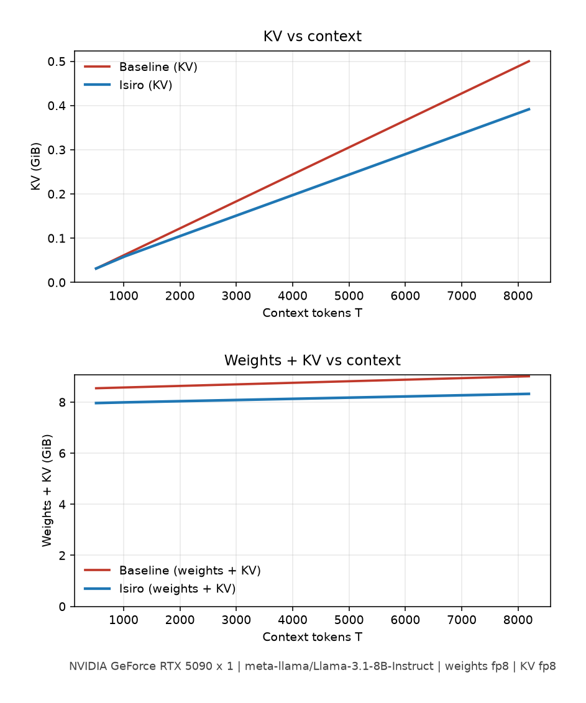

# ISIRO Benchmark Report: `llama-3.1-8b-instruct-fp8`

`fp8` | `rtx-5090` | compiler `v0.1.1` | runtime `v0.1.1` | 2026-10-11 19:38 UTC

Tooling:

- `vllm bench serve` (tok/s, ITL)

Compared:

- **Baseline:** vLLM (`vllm serve` / Docker `vllm/vllm-openai`) with `--kv-cache-dtype fp8`
- **Isiro:** `isiro serve … --target vllm` with TIC weights and `ISIRO_GDX=fp8` (same vLLM version; cold KV compress on vendor attention pages)

GDX cold coding-rate vs naive vendor KV bits (estimate): bf16 ~29-31% vs 16 bpv; fp8 ~19-25% vs 8 bpv. Section A GPU memory is the reserved vendor KV pool, not coded cold bytes.

## Correctness

| Metric | Baseline | Isiro |
|--------|----------|-------|
| On-disk model size | 9.08 GB | **8.47 GB** (**6.79% smaller**) |
| Integrity | baseline weights | **PASS** (`isiro verify`) |
| KV bit-exactness | vendor KV pages | **PASS** (GDX `fp8` cold roundtrip) |
| Serve output match | - | FAIL (3/4 prompts matched (temp=0 token IDs)) |

## A. GPU memory

Savings % uses `1 - Isiro/Baseline` for loaded weights.

### Weights

| Metric | Baseline | Isiro | Savings % |
|--------|----------|-------|-----------|
| GPU memory for loaded weights | 8.51 GiB | **7.93 GiB** | **6.82%** |

### KV cache

| Metric | Baseline default fill | Isiro reserved KV |
|--------|-----------------------|-------------------|
| GPU memory reserved for KV | 18.01 GiB (295008 tokens) | 19.05 GiB (312176 tokens)† |

† Reserved pool on the GPU at vendor KV bytes/token. Token counts are pool admission slots (same bpv as the vendor dtype), not GDX-coded cold capacity. Longer context uses persist after vendor reclaim of prefix blocks (TokenIDs plus archived K,V). Not a second vendor KV cache on the host.

### KV vs context

`ISIRO_GDX=fp8` on vendor FA fp8 KV pages from a Project Gutenberg prefill (`kv_source=vendor_fa_pages`). At T=8192: Baseline KV 0.50 GiB, Isiro KV 0.39 GiB; save 0.11 GiB (21.7%). Bottom panel adds loaded weights (Baseline 8.51 GiB, Isiro 7.93 GiB): at T=8192, Baseline 9.01 GiB vs Isiro 8.32 GiB (weights + KV).

Figure. Weights and KV vs 1-user context.

## C. Capacity

Concurrent requests are 32 on both sides. Not scaled from KV token capacity.

Concurrent requests are the serve max concurrent sequences (`max_num_seqs`); the bench load matches that ceiling in this A/B. KV token capacity is reserved pool slots when Isiro printed KV pool, else vLLM GPU tokens in this serve's reserved GPU pool.

| Metric | Baseline | Isiro |
|--------|----------|-------|
| Concurrent requests | 32 | 32 |
| KV token capacity | 295008 (18.01 GiB KV) | **312176 (19.05 GiB KV)†** |

### Generation (recall-matched KV, input 32 / output 256)

Tok/s is aggregate system throughput across in-flight requests. Per-request decode rate is reflected by ITL/TPOT. Concurrent requests are in Capacity. Latency-matched wins live in Equal batch (same conc as Baseline, vendor compile band). Higher Capacity concurrency raises aggregate tok/s and can move TTFT/ITL; the harness may raise max_num_batched_tokens for one prefill wave (not an ISIRO invent lock).

| Metric | Baseline | Isiro |
|--------|----------|-------|
| Output tok/s | 2230.39 | **4599.28** |
| ITL (ms) p50 / p95 / p99 | 14.01 / 14.97 / 15.34 | 6.55 / 7.64 / 13.16 |
| TPOT (ms) p50 / p95 / p99 | 14.06 / 14.09 / 14.12 | 6.65 / 6.65 / 6.70 |
| TTFT (ms) p50 / p95 / p99 | 85.00 / 85.80 / 86.04 | 68.15 / 91.48 / 91.52 |

## Config

| Item | Value |
|------|-------|
| System | `rtx-5090` |
| CUDA graphs | on (eager prefill, graph decode) |
| Weights | `fp8` |
| KV cache | dtype `fp8`; `ISIRO_GDX=fp8` on Isiro |
| Compiler | `v0.1.1` |
| Runtime | `v0.1.1` |
| vLLM | 0.31.0 |
| GPU | NVIDIA GeForce RTX 5090 x 1 |
| Driver / CUDA | 590.44.01 / 13.1 |
| ISIRO_GDX | `fp8` |
| Isiro attention | `CUSTOM` (`ISIRO_ATTN` unset) |
| Baseline attention | `FLASHINFER` |

Fairness check: **PASS**.
