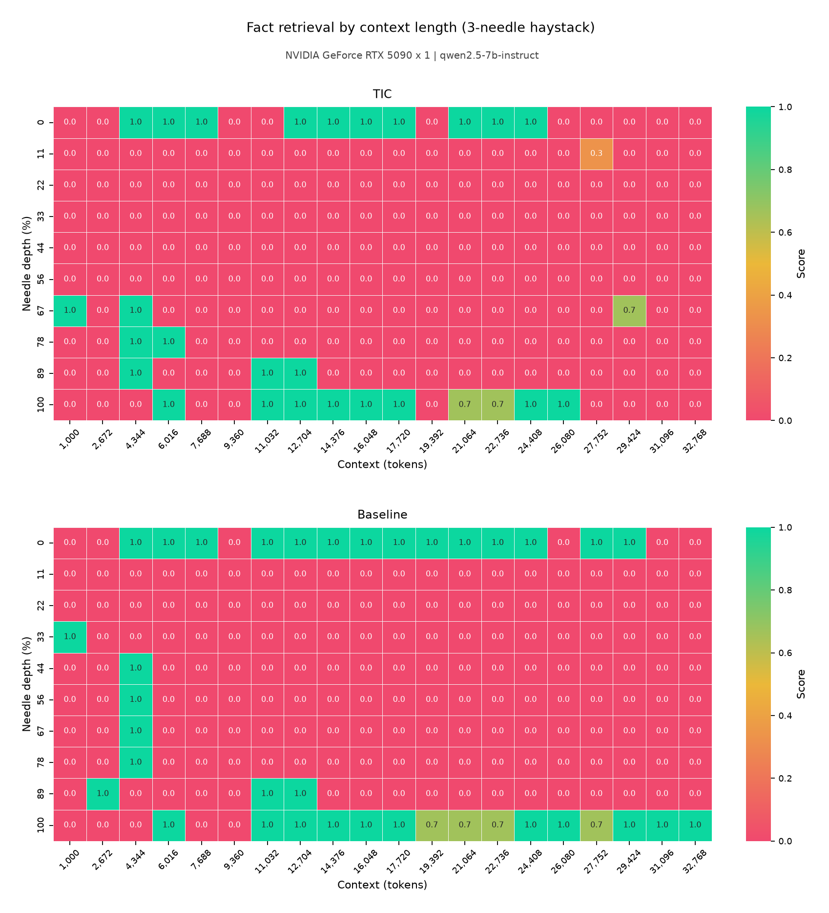
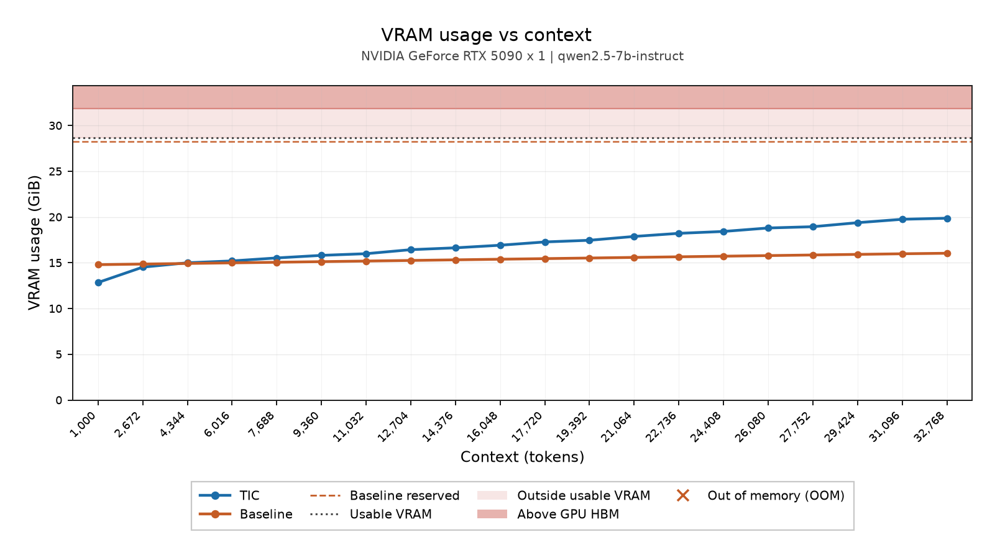

# ISIRO Benchmark Report: `qwen2.5-7b-instruct`

`bf16` | `rtx-5090` | compiler `auto` | runtime `auto` | 2026-08-31 02:50 UTC

Tooling:

- `vllm bench serve` (tok/s, ITL)
- Needle-in-a-haystack (3-needle; Kamradt / RULER / EvalScope-style) for long-context recall

Compared:

- **Baseline:** vLLM (`vllm serve` / Docker `vllm/vllm-openai`)
- **TIC:** `isiro serve … --target vllm` (same vLLM version)

## Correctness

| Metric | Baseline | TIC |
|--------|----------|-----|
| On-disk model size | 15.23 GB | **10.78 GB** (**29.22% smaller**) |
| Weight bit-exactness | baseline weights | **PASS** (`isiro verify -r`) |
| Serve output match | - | **PASS** (4/4 prompts, temp=0, token IDs equal) |

## A. GPU memory

### Weights

| Metric | Baseline | TIC | Savings % |
|--------|----------|-----|-----------|
| GPU memory for loaded weights | 14.29 GiB | **10.42 GiB** | **27.08%** |

### KV cache

| Metric | Baseline default fill | TIC reserved KV | Savings % |
|--------|-----------------------|-----------------|-----------|
| GPU memory reserved for KV | 12.71 GiB (238064 tokens) | **1.09 GiB** (20480 tokens)† | **91.42%** |

† Reserved pool on the GPU. Longer context uses persist after vendor reclaim of prefix blocks (TokenIDs plus archived K,V). Not a second vendor KV cache on the host.

## B. Needle-in-a-haystack (context tokens × depth)

Same long prompt, needles, and question on every setup that starts. The Baseline serve would not start at 1.09 GiB.

X is context tokens. Y is needle depth % (0 = start of prompt, 100 = end). Color is recall. An X in a column is OOM, same as the VRAM figure.

Figure. Fact retrieval by context length (3-needle haystack).

Figure. VRAM usage vs context tokens.

Solid line is reported non-KV plus vLLM pool occupancy (metrics, or derived T/pool if /metrics is missing). Dashed line is Baseline non-KV plus its reserved KV pool. The dotted line is usable VRAM. The light red band is above usable VRAM. The darker red band is above GPU HBM. An X on the GPU HBM line is OOM at that context. Reported non-KV plus pool occupancy, not a process nvidia-smi meter.

## C. Capacity

Batch is 32 on both sides. Not scaled from KV token capacity.

KV token capacity is dest lock slots when TIC printed KV pool, else vLLM GPU tokens in this serve's reserved GPU pool.

| Metric | Baseline | TIC |
|--------|----------|-----|
| Batch | 32 | 32 |
| KV token capacity | 238064 (12.71 GiB KV) | 20480 (1.09 GiB KV)† |

## D. Generation (recall-matched KV, input 32 / output 256)

Tok/s and latency at the recall-matched KV sizes. Batch is in Capacity. Not equal batch (E). TTFT is in this table because it moves with concurrency.

| Metric | Baseline | TIC |
|--------|----------|-----|
| Output tok/s | 1881.28 | 1589.81 |
| ITL (ms) p50 / p95 / p99 | 10.56 / 11.45 / 12.05 | 12.50 / 13.94 / 26.03 |
| TPOT (ms) p50 / p95 / p99 | 10.68 / 10.88 / 11.06 | 12.75 / 12.79 / 13.15 |
| TTFT (ms) p50 / p95 / p99 | 92.07 / 147.88 / 147.99 | 217.65 / 218.06 / 218.12 |

## E. Equal batch

Same batch as Capacity.

| Metric | Baseline | TIC |
|--------|----------|-----|
| Output tok/s | 1881.28 | 1589.81 |
| ITL (ms) p50 / p95 / p99 | 10.56 / 11.45 / 12.05 | 12.50 / 13.94 / 26.03 |
| TPOT (ms) p50 / p95 / p99 | 10.68 / 10.88 / 11.06 | 12.75 / 12.79 / 13.15 |
| TTFT (ms) p50 / p95 / p99 | 92.07 / 147.88 / 147.99 | 217.65 / 218.06 / 218.12 |

## Config

| Item | Value |
|------|-------|
| System | `rtx-5090` |
| CUDA graphs | on (eager prefill, graph decode) |
| KV cache | product KV cache size |
| Compiler | `auto` |
| Runtime | `auto` |
| vLLM | 0.26.0 |
| GPU | NVIDIA GeForce RTX 5090 x 1 |
| Driver / CUDA | 590.44.01 / 13.1 |
| TIC attention | `CUSTOM` (`ISIRO_ATTN` unset) |
| Baseline attention | `FLASH_ATTN` |

Fairness check: **PASS**.
