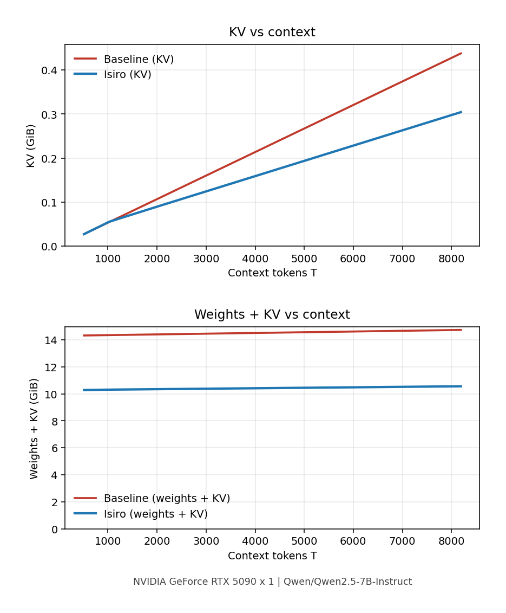

# ISIRO Benchmark Report: `qwen2.5-7b-instruct`

`bf16` | `rtx-5090` | compiler `v0.1.1` | runtime `v0.1.1` | 2026-10-10 02:08 UTC

Tooling:

- `vllm bench serve` (tok/s, ITL)

Compared:

- **Baseline:** vLLM (`vllm serve` / Docker `vllm/vllm-openai`) with `--kv-cache-dtype bfloat16`
- **Isiro:** `isiro serve … --target vllm` with TIC weights and `ISIRO_KV=bf16` (same vLLM version; cold KV compress on vendor attention pages)

Isiro KV cold coding-rate vs naive vendor KV bits (estimate): bf16 ~29-31% vs 16 bpv; fp8 ~19-25% vs 8 bpv. Section A GPU memory is the reserved vendor KV pool, not coded cold bytes.

## Correctness

| Metric | Baseline | Isiro |
|--------|----------|-------|
| On-disk model size | 15.23 GB | **10.78 GB** (**29.22% smaller**) |
| Integrity | baseline weights | **PASS** (`isiro verify`) |
| KV bit-exactness | vendor KV pages | **PASS** (Isiro KV `bf16` cold roundtrip) |
| Serve output match | - | **PASS** (4/4 prompts, temp=0, token IDs equal) |

## A. GPU memory

Savings % uses `1 - Isiro/Baseline` for loaded weights.

### Weights

| Metric | Baseline | Isiro | Savings % |
|--------|----------|-------|-----------|
| GPU memory for loaded weights | 14.29 GiB | **10.25 GiB** | **28.27%** |

### KV cache

| Metric | Baseline default fill | Isiro reserved KV |
|--------|-----------------------|-------------------|
| GPU memory reserved for KV | 12.56 GiB (235120 tokens) | 15.14 GiB (283568 tokens)† |

† Reserved pool on the GPU at vendor KV bytes/token. Token counts are pool admission slots (same bpv as the vendor dtype), not Isiro-KV-coded cold capacity. Longer context uses persist after vendor reclaim of prefix blocks (TokenIDs plus archived K,V). Not a second vendor KV cache on the host.

### KV vs context

`ISIRO_KV=bf16` on KV from a Project Gutenberg text forward. At T=8192: Baseline KV 0.44 GiB, Isiro KV 0.30 GiB; save 0.13 GiB (30.5%). Bottom panel adds loaded weights (Baseline 14.29 GiB, Isiro 10.25 GiB): at T=8192, Baseline 14.73 GiB vs Isiro 10.55 GiB (weights + KV).

Figure. Weights and KV vs 1-user context.

## C. Equal batch

Same concurrent-request ceiling as Baseline (latency-matched surface: vendor compile band, hybrid dens~1). Capacity-matched generation in D raises concurrency for aggregate tok/s; ITL/TTFT there are not the equal-batch claim.

| Metric | Baseline | Isiro |
|--------|----------|-------|
| Concurrent requests | 32 | 32 |
| Output tok/s | 2825.49 | 2770.60 |
| ITL (ms) p50 / p95 / p99 | 10.65 / 12.70 / 13.12 | 10.88 / 12.29 / 22.72 |
| TPOT (ms) p50 / p95 / p99 | 10.74 / 11.05 / 11.11 | 11.08 / 11.08 / 11.25 |
| TTFT (ms) p50 / p95 / p99 | 156.79 / 157.33 / 157.68 | 114.86 / 189.76 / 189.90 |

## D. Capacity

Isiro concurrent requests = round(Baseline × Isiro/Baseline KV token capacity) from a matched vLLM KV measurement, then rounded up onto the vLLM CUDA-graph capture stride (multiples of 8) so FULL decode graphs cover concurrency.

Concurrent requests are the serve max concurrent sequences (`max_num_seqs`); the bench load matches that ceiling in this A/B. KV token capacity is reserved pool slots when Isiro printed KV pool, else vLLM GPU tokens in this serve's reserved GPU pool.

| Metric | Baseline | Isiro |
|--------|----------|-------|
| Concurrent requests | 32 | **40** (**1.25x**) |
| KV token capacity | 235120 (12.56 GiB KV) | **283568 (15.14 GiB KV)†** |

### Generation (recall-matched KV, input 32 / output 256)

Tok/s is aggregate system throughput across in-flight requests. Per-request decode rate is reflected by ITL/TPOT. Concurrent requests are in Capacity. Not equal batch (C). Latency-matched wins live in Equal batch (same conc as Baseline, vendor compile band). Higher Capacity concurrency raises aggregate tok/s and can move TTFT/ITL; the harness may raise max_num_batched_tokens for one prefill wave (not an ISIRO invent lock).

| Metric | Baseline | Isiro |
|--------|----------|-------|
| Output tok/s | 2825.49 | **2909.09** |
| ITL (ms) p50 / p95 / p99 | 10.65 / 12.70 / 13.12 | 12.79 / 14.44 / 26.87 |
| TPOT (ms) p50 / p95 / p99 | 10.74 / 11.05 / 11.11 | 13.13 / 13.13 / 13.34 |
| TTFT (ms) p50 / p95 / p99 | 156.79 / 157.33 / 157.68 | 147.49 / 222.41 / 222.51 |

## Config

| Item | Value |
|------|-------|
| System | `rtx-5090` |
| CUDA graphs | on (eager prefill, graph decode) |
| Weights | `bf16` |
| KV cache | dtype `bfloat16`; `ISIRO_KV=bf16` on Isiro |
| Compiler | `v0.1.1` |
| Runtime | `v0.1.1` |
| vLLM | 0.31.0 |
| GPU | NVIDIA GeForce RTX 5090 x 1 |
| Driver / CUDA | 590.44.01 / 13.1 |
| ISIRO_KV | `bf16` |
| Isiro attention | `CUSTOM` (`ISIRO_ATTN` unset) |
| Baseline attention | `FLASH_ATTN` |

Fairness check: **PASS**.
