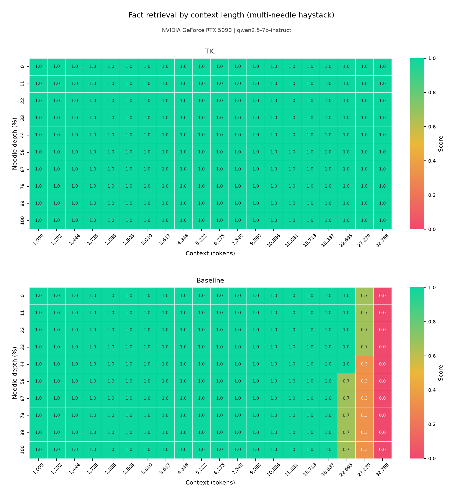

# ISIRO Benchmark Report: `qwen2.5-7b-instruct`

`bf16` | `rtx-5090` | compiler `v0.1.1` | runtime `v0.1.1` | 2026-08-22 03:01 UTC

Tooling:

- `vllm bench serve` (tok/s, ITL)
- Needle-in-a-haystack (3-needle; Kamradt / RULER / EvalScope-style) for long-context recall

Compared:

- **Baseline:** vLLM (`vllm serve` / Docker `vllm/vllm-openai`)
- **Isiro:** `isiro serve … --target vllm` (same vLLM version)

This directory is a mock: tables and figures use invented numbers so you can see the layout. A real `run_ab.sh` write looks the same (`report.md` plus the two PNGs).

## Correctness

| Metric             | Baseline         | Isiro                                           |
| ------------------ | ---------------- | ----------------------------------------------- |
| On-disk model size | 15.23 GB         | **10.78 GB** (**29.22% smaller**)               |
| Integrity          | baseline weights | **PASS** (`isiro verify`)                       |
| Serve output match | -                | **PASS** (4/4 prompts, temp=0, token IDs equal) |

## A. GPU memory

Savings % uses `1 - Isiro/Baseline` for loaded weights. For KV it uses `Isiro/Baseline - 1` as a % gain (and the matching `x` ratio).

### Weights

| Metric                        | Baseline | Isiro         | Savings %  |
| ----------------------------- | -------- | ------------- | ---------- |
| GPU memory for loaded weights | 15.34 GiB | **11.19 GiB** | **27.08%** |

### KV cache

| Metric                     | Baseline default fill     | Isiro reserved KV                | Savings %           |
| -------------------------- | ------------------------- | -------------------------------- | ------------------- |
| GPU memory reserved for KV | 12.71 GiB (238064 tokens) | **15.19 GiB** (288064 tokens)†   | **19.51% (1.21x)**  |

† Reserved pool on the GPU at vendor KV bytes/token. Token counts are pool admission slots, not Isiro-KV-coded cold capacity. Longer context uses persist after vendor reclaim of prefix blocks (TokenIDs plus archived K,V). Not a second vendor KV cache on the host.

## B. Needle-in-a-haystack (context tokens × depth)

Same long prompt, needles, and question on every setup that starts.

X is context tokens. Y is needle depth % (0 = start of prompt, 100 = end). Color is recall. An X in a column is OOM, same as the VRAM figure.

Figure. Fact retrieval by context length (3-needle haystack).

Figure. VRAM usage vs context tokens.

Solid line is in-use: non-KV (weights) plus live vendor KV (usage_perc times pool, or derived T/pool) plus TokenID/persist outside the pool. Dashed lines are reserved pools (non-KV plus the full KV lock or fill). The dotted line is usable VRAM. The light red band is above usable VRAM. The darker red band is above GPU HBM. An X on the GPU HBM line is OOM at that context. Not nvidia-smi.

## C. Equal batch

Same concurrent-request ceiling as Baseline. ITL stays near Baseline; capacity-matched generation in D raises concurrency and ITL.

| Metric                    | Baseline                | Isiro                    |
| ------------------------- | ----------------------- | ------------------------ |
| Concurrent requests       | 32                      | 32                       |
| Output tok/s              | 1876.21                 | 1888.40                  |
| ITL (ms) p50 / p95 / p99  | 10.65 / 11.35 / 11.89   | 10.70 / 12.10 / 22.40    |
| TPOT (ms) p50 / p95 / p99 | 10.83 / 10.90 / 11.11   | 10.90 / 11.20 / 11.30    |
| TTFT (ms) p50 / p95 / p99 | 159.40 / 160.30 / 160.50 | 96.80 / 189.20 / 189.30 |

## D. Capacity

Isiro concurrent requests = round(Baseline × Isiro/Baseline KV token capacity) from a matched vLLM KV measurement, then rounded up onto the vLLM CUDA-graph capture stride (multiples of 8) so FULL decode graphs cover concurrency.

Concurrent requests are the serve max concurrent sequences (`max_num_seqs`); the bench load matches that ceiling in this A/B. KV token capacity is reserved pool slots when Isiro printed KV pool, else vLLM GPU tokens in this serve's reserved GPU pool.

| Metric               | Baseline              | Isiro                        |
| -------------------- | --------------------- | ---------------------------- |
| Concurrent requests  | 32                    | **40** (**1.25x**)           |
| KV token capacity    | 238064 (12.71 GiB KV) | **288064** (15.19 GiB KV)† |

### Generation (recall-matched KV, input 32 / output 256)

Tok/s is aggregate system throughput across in-flight requests. Per-request decode rate is reflected by ITL/TPOT. Concurrent requests are in Capacity. Not equal batch (C). TTFT moves with concurrency; at higher concurrency a vendor batched-token budget that fits one prefill wave keeps TTFT near equal-batch (harness capacity overlay; not an ISIRO invent lock).

| Metric                    | Baseline                | Isiro                    |
| ------------------------- | ----------------------- | ------------------------ |
| Output tok/s              | 1876.21                 | **2910.00**              |
| ITL (ms) p50 / p95 / p99  | 10.65 / 11.35 / 11.89   | 10.90 / 12.20 / 22.50    |
| TPOT (ms) p50 / p95 / p99 | 10.83 / 10.90 / 11.11   | 11.00 / 11.30 / 11.40    |
| TTFT (ms) p50 / p95 / p99 | 100.60 / 158.10 / 158.20 | 98.50 / 160.20 / 160.40 |

## Config

| Item          | Value                            |
| ------------- | -------------------------------- |
| System        | `rtx-5090`                       |
| CUDA graphs   | on (eager prefill, graph decode) |
| KV cache      | product KV cache size            |
| Compiler      | `v0.1.1`                         |
| Runtime       | `v0.1.1`                         |
| vLLM          | 0.26.0                           |
| GPU           | NVIDIA GeForce RTX 5090 x 1      |
| Driver / CUDA | 590.44.01 / 13.1                 |

Fairness check: **PASS**.
