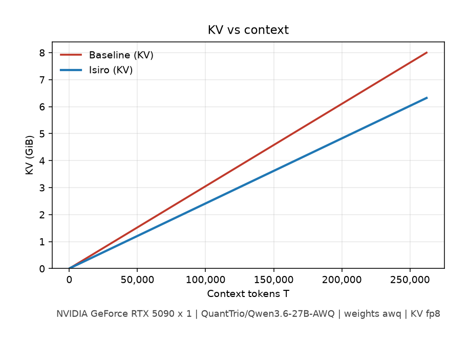

# ISIRO Benchmark Report: `qwen3.6-27b-awq`

`awq` | `rtx-5090` | compiler `kv-only` | runtime `kv-only` | 2026-11-06 02:42 UTC

Tooling:

- `vllm bench serve` (tok/s, ITL)

Compared:

- **Baseline:** vLLM (`vllm serve` / Docker `vllm/vllm-openai`) with `--kv-cache-dtype fp8`
- **Isiro KV-only:** `vllm serve` + `ISIRO_KV=fp8` (same AWQ/HF weights as baseline; no TIC weight claim)

Section A: loaded weights and Available KV GiB are shared (same raw weights, same vendor util). KV tokens capacity and Capacity concurrency follow the measured Isiro/Baseline token ratio on that budget. KV bytes vs context are under KV vs context when the curve ran.

TIME claim: **GO** on equal-batch (conc=8; tok/s 525.17 vs 525.23; ITL 14.76 vs 14.76; TTFT 134.06 vs 132.77).

## Correctness

| Metric | Result |
|--------|--------|
| KV bit-exactness | **PASS** (Isiro KV `fp8` roundtrip) |
| Serve output match | **PASS** (4/4 prompts, temp=0, token IDs equal) |

## A. GPU memory

Loaded weights are identical on both arms (no TIC weight claim).

### Weights

| Metric | Value |
|--------|-------|
| GPU memory for loaded weights | 19.92 GiB |

### Available KV

| Metric | Value |
|--------|-------|
| Available KV | 4.08 GiB |

Available KV is the vendor reserved pool on the GPU (same util target both arms; no TIC weight headroom).

### KV tokens capacity

Same Available KV GiB both arms. Isiro KV fits more tokens in that pool (measured scale ≈ 1.27).

| Metric | Baseline | Isiro |
|--------|----------|-------|
| KV tokens capacity | 77,368 | **96,623** (**+25%**) |

### KV vs context

`ISIRO_KV=fp8` on KV from a Project Gutenberg text forward. At T=262,144: Baseline KV 8.00 GiB, Isiro KV 6.32 GiB; save 1.68 GiB (21.0%).

Figure. KV vs 1-user context.

## C. Equal batch

Same concurrent-request ceiling as Baseline (latency-matched surface). Capacity-matched generation in D raises concurrency for aggregate tok/s; ITL/TTFT there are not the equal-batch claim.

| Metric | Baseline | Isiro |
|--------|----------|-------|
| Concurrent requests | 8 | 8 |
| Output tok/s | 525.23 | 525.17 |
| ITL (ms) p50 / p95 / p99 | 14.76 / 15.13 / 15.36 | 14.76 / 15.12 / 15.28 |
| TPOT (ms) p50 / p95 / p99 | 14.77 / 14.86 / 14.89 | 14.76 / 14.85 / 14.89 |
| TTFT (ms) p50 / p95 / p99 | 132.77 / 133.09 / 133.11 | 134.06 / 134.34 / 134.37 |

## D. Capacity

Isiro concurrent requests = round(Baseline × Isiro/Baseline KV token capacity), then rounded up onto the vLLM CUDA-graph capture stride (multiples of 8) so FULL decode graphs cover concurrency.

Concurrent requests are the serve max concurrent sequences (`max_num_seqs`); the bench load matches that ceiling in this A/B.

| Metric | Baseline | Isiro |
|--------|----------|-------|
| Concurrent requests | 8 | **16** (**+100%**) |

### Generation (recall-matched KV, input 32 / output 256)

Tok/s is aggregate system throughput across in-flight requests. Per-request decode rate is reflected by ITL/TPOT. Concurrent requests are in Capacity. Not equal batch (C). Latency-matched wins live in Equal batch (same conc as Baseline). Higher Capacity concurrency raises aggregate tok/s and can move TTFT/ITL.

| Metric | Baseline | Isiro |
|--------|----------|-------|
| Output tok/s | 525.23 | **946.34** |
| ITL (ms) p50 / p95 / p99 | 14.76 / 15.13 / 15.36 | 16.05 / 16.67 / 16.85 |
| TPOT (ms) p50 / p95 / p99 | 14.77 / 14.86 / 14.89 | 16.08 / 16.16 / 16.35 |
| TTFT (ms) p50 / p95 / p99 | 132.77 / 133.09 / 133.11 | 225.47 / 226.36 / 226.37 |

## Config

| Item | Value |
|------|-------|
| System | `rtx-5090` |
| CUDA graphs | on (eager prefill, graph decode) |
| Weights | `awq` |
| KV cache | dtype `fp8`; `ISIRO_KV=fp8` on Isiro |
| Compiler | `kv-only` |
| Runtime | `kv-only` |
| vLLM | 0.31.0 |
| GPU | NVIDIA GeForce RTX 5090 x 1 |
| Driver / CUDA | 590.44.01 / 13.1 |
| ISIRO_KV | `fp8` |
| Isiro attention | `FLASH_ATTN` (`ISIRO_ATTN` unset) |
| Baseline attention | `FLASH_ATTN` |

Fairness check: **PASS**.
