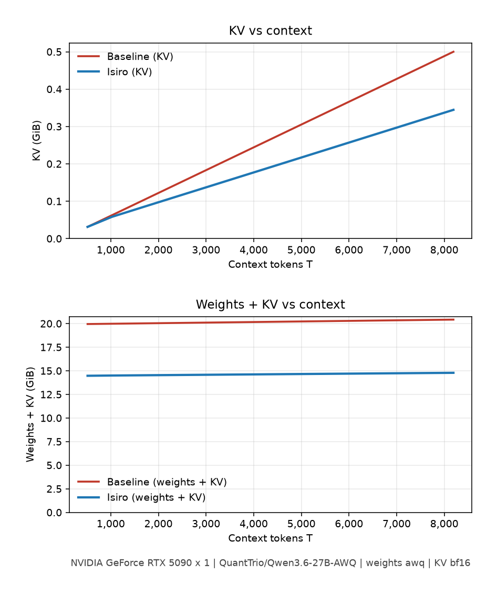

# ISIRO Benchmark Report: `qwen3.6-27b-awq`

`awq` | `rtx-5090` | compiler `v0.1.1` | runtime `v0.1.1` | 2026-10-24 02:34 UTC

Tooling:

- `vllm bench serve` (tok/s, ITL)

Compared:

- **Baseline:** vLLM (`vllm serve` / Docker `vllm/vllm-openai`) with `--kv-cache-dtype bfloat16`
- **Isiro:** `isiro serve … --target vllm` with TIC weights and `ISIRO_GDX=bf16` (same vLLM version; cold KV compress on vendor attention pages)

Section A GPU memory is the reserved vendor KV pool, not coded cold bytes. Measured GDX cold vs FA twin bytes (when the curve ran) are under KV vs context.

## Correctness

| Metric | Baseline | Isiro |
|--------|----------|-------|
| On-disk model size | 21.85 GB | **18.50 GB** (**15.35% smaller**) |
| Integrity | baseline weights | **PASS** (`isiro verify`) |
| KV bit-exactness | vendor KV pages | **PASS** (GDX `bf16` cold roundtrip) |
| Serve output match | - | **PASS** (4/4 prompts, temp=0, token IDs equal) |

## A. GPU memory

Savings % uses `1 - Isiro/Baseline` for loaded weights.

### Weights

| Metric | Baseline | Isiro | Savings % |
|--------|----------|-------|-----------|
| GPU memory for loaded weights | 19.92 GiB | **14.44 GiB** | **27.51%** |

### KV cache

| Metric | Baseline default fill | Isiro reserved KV |
|--------|-----------------------|-------------------|
| GPU memory reserved for KV | 4.47 GiB | 4.18 GiB† |

† Reserved vendor GPU KV pool GiB (same util target as Baseline). Under GDX this is not coded cold capacity; longer context uses persist after vendor reclaim of prefix blocks (TokenIDs plus archived K,V). Not a second vendor KV cache on the host.

### KV vs context

`ISIRO_GDX=bf16` on KV from a Project Gutenberg text forward. At T=8192: Baseline KV 0.50 GiB, Isiro KV 0.34 GiB; save 0.16 GiB (31.1%). Bottom panel adds loaded weights (Baseline 19.92 GiB, Isiro 14.44 GiB): at T=8192, Baseline 20.42 GiB vs Isiro 14.78 GiB (weights + KV).

Figure. Weights and KV vs 1-user context.

## C. Capacity

Concurrent requests are 8 on both sides. Not scaled from KV token capacity.

Concurrent requests are the serve max concurrent sequences (`max_num_seqs`); the bench load matches that ceiling in this A/B. KV pool is the reserved vendor GPU KV GiB (same util target as Baseline). Under GDX, vendor token slots are not effective cold capacity; GiB is the fair A/B meter.

| Metric | Baseline | Isiro |
|--------|----------|-------|
| Concurrent requests | 8 | 8 |
| KV pool | 4.47 GiB | 4.18 GiB† |

### Generation (recall-matched KV, input 32 / output 256)

Tok/s is aggregate system throughput across in-flight requests. Per-request decode rate is reflected by ITL/TPOT. Concurrent requests are in Capacity. Latency-matched wins live in Equal batch (same conc as Baseline, vendor compile band). Higher Capacity concurrency raises aggregate tok/s and can move TTFT/ITL; the harness may raise max_num_batched_tokens for one prefill wave (not an ISIRO invent lock).

| Metric | Baseline | Isiro |
|--------|----------|-------|
| Output tok/s | 524.05 | 514.75 |
| ITL (ms) p50 / p95 / p99 | 14.79 / 15.17 / 15.40 | 14.98 / 15.71 / 16.37 |
| TPOT (ms) p50 / p95 / p99 | 14.80 / 14.89 / 14.93 | 14.97 / 15.04 / 15.07 |
| TTFT (ms) p50 / p95 / p99 | 132.70 / 132.94 / 132.94 | 159.55 / 159.77 / 159.78 |

## Config

| Item | Value |
|------|-------|
| System | `rtx-5090` |
| CUDA graphs | on (eager prefill, graph decode) |
| Weights | `awq` |
| KV cache | dtype `bfloat16`; `ISIRO_GDX=bf16` on Isiro |
| Compiler | `v0.1.1` |
| Runtime | `v0.1.1` |
| vLLM | 0.31.0 |
| GPU | NVIDIA GeForce RTX 5090 x 1 |
| Driver / CUDA | 590.44.01 / 13.1 |
| ISIRO_GDX | `bf16` |
| Isiro attention | `FLASH_ATTN` (`ISIRO_ATTN` unset) |
| Baseline attention | `FLASH_ATTN` |

Fairness check: **PASS**.
